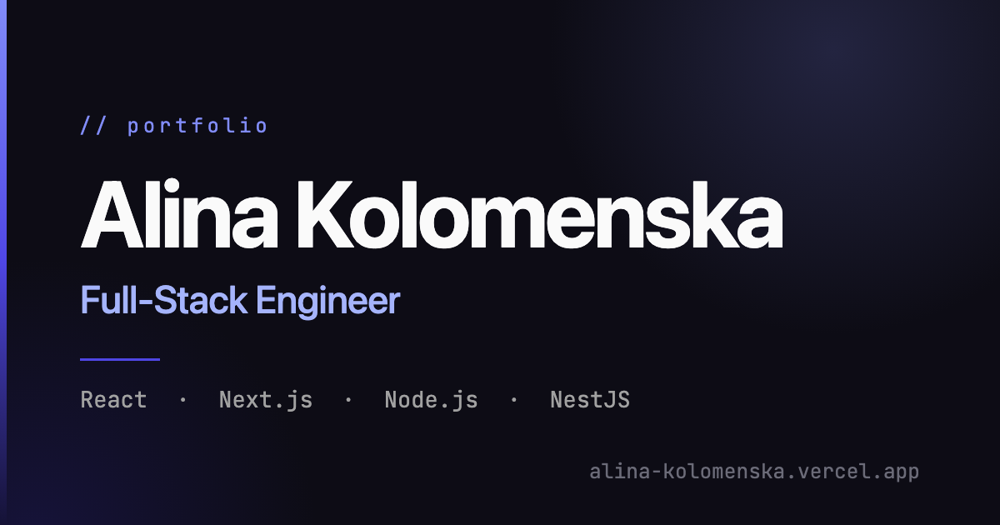

# Alina Kolomenska — Portfolio

Personal portfolio of a full-stack engineer with a strong frontend focus.

**Live:** [alina-kolomenska.vercel.app](https://alina-kolomenska.vercel.app/)



## Stack

- React 19 and TypeScript
- Vite
- Tailwind CSS v4
- shadcn/ui on Radix primitives, with Lucide icons
- Deployed on Vercel

## Features

- Light and dark themes that follow the system preference, remember the visitor's choice, and apply before first paint
- Responsive sidebar navigation that highlights the section in view
- Collapsible project cards and job highlights
- Certificate and diploma previews that open full size in a dialog
- Accessible by default: skip link, landmarks, screen-reader labels, and smooth scrolling only when reduced motion isn't requested
- Open Graph, Twitter card, and JSON-LD metadata for link previews and search

## Editing content

All copy lives in data files, so updating the site never means touching components:

| File | Content |
| --- | --- |
| `src/content/profile.ts` | Name, role, contact links, stats, languages |
| `src/content/about.ts` | About section |
| `src/content/experience.ts` | Job positions |
| `src/content/education.ts` | Education |
| `src/data/projects.json` | Projects |
| `src/data/skills.json` | Skill groups |

The shapes are defined in `src/types/content.ts`. `profile.ts` also accepts two optional fields: `resumeUrl` adds a "Download CV" button to the sidebar, and `introVideo` adds a video intro to the About section. Education entries can attach a `document` (title, full image, thumbnail, alt text, and pixel size), with the images in `public/education/`.

Page metadata and the share image live in `index.html` and `public/og.png`. Update both if the name, role, or domain changes.

## Development

Requires Node.js 20.19+ or 22.12+.

```bash
npm install
npm run dev       # start the dev server
npm run build     # type-check and build for production
npm run lint      # run ESLint
npm run preview   # preview the production build locally
```
